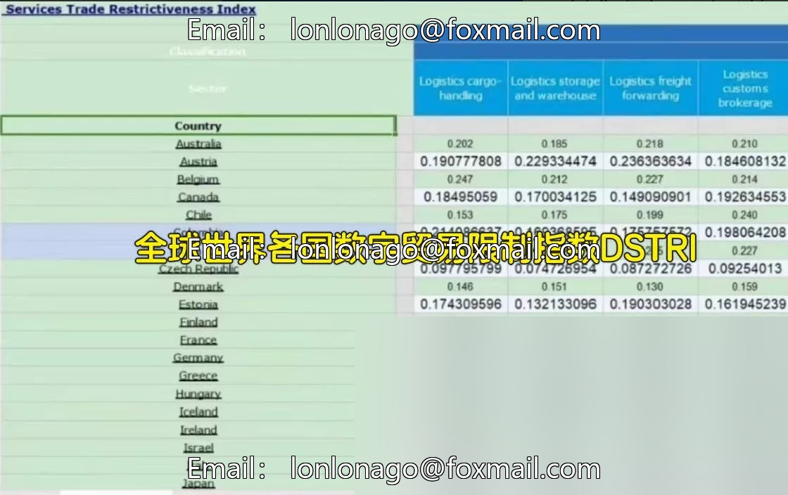
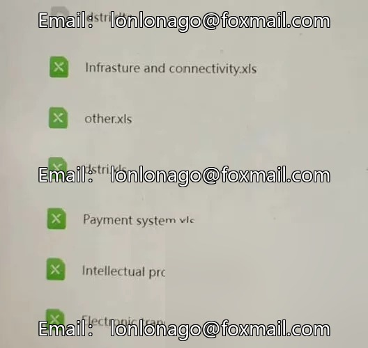
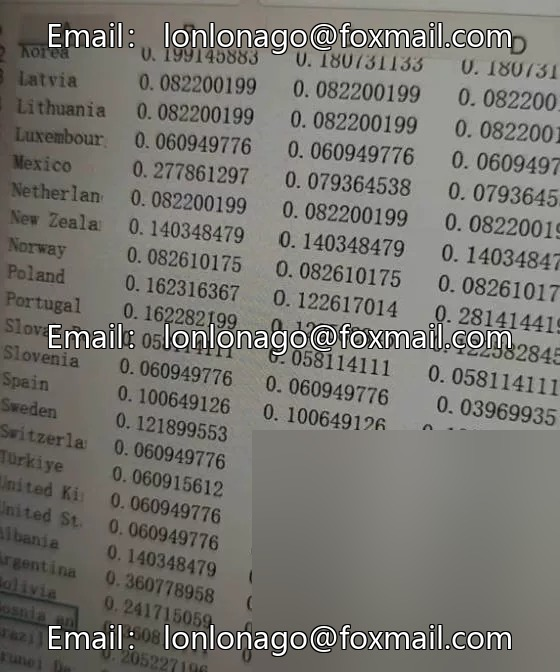

# Global and world digital trade restriction index DSTRI

## Body

Global and world countries' digital trade restriction index DSTRI
Infrastructure and connectivity intellectual property barriers for electronic trading and payment systems
DSTRI 2014-2021 Data source OECD
Organized DTA document!!! Can be directly inserted into the regression and run, and there are no missing values!

Indicators included are:
Indicator STRI Digital Trade Restriction Index DSTRI
Infrastructure and connectivity Infrastructure and connectivity
Electronic transactions Electronic transactions
Payment system Payment system
Intellectual property rights Intellectual property rights
Other barriers affecting trade in digitally enabled services Other barriers affecting trade in digitally enabled services

This attachment includes:
dstri.xls
indicator.xls
dstri.dta

web-based shipment, can be directly photographed and shipped.

The data covers the Global Digital Trade Restrictiveness Index DSTRI, infrastructure and connectivity, electronic transactions, payment systems and intellectual property rights, along with associated DSTRI documents and xls files.

<!-- AI_ENRICHED -->

## Images

## Payment

Here is a pay link on Stripe ( https://buy.stripe.com/3cs8yP7sY87d0vu9AB ). Please contact me lonlonago@foxmail.com after funding $89, and I will send you a complete data files , thank you!

